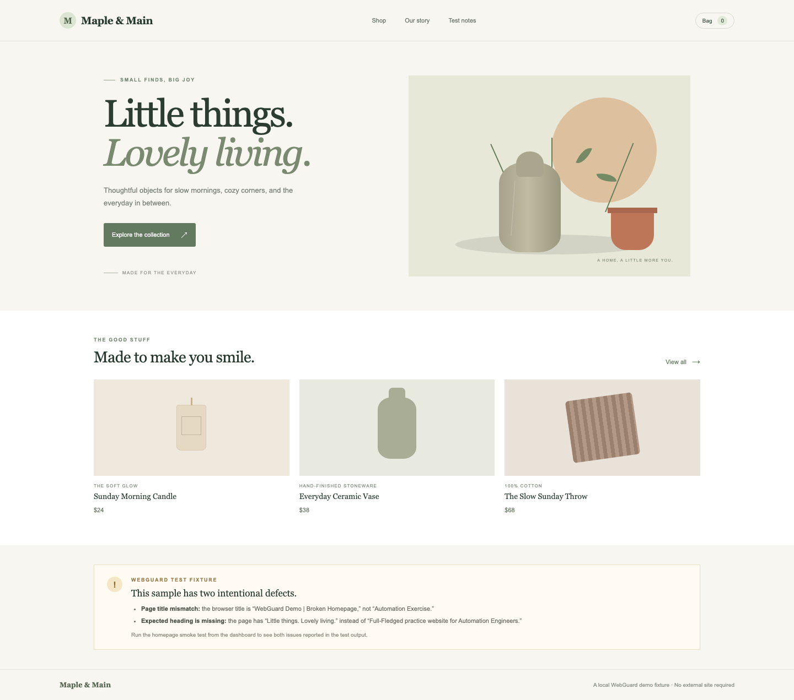
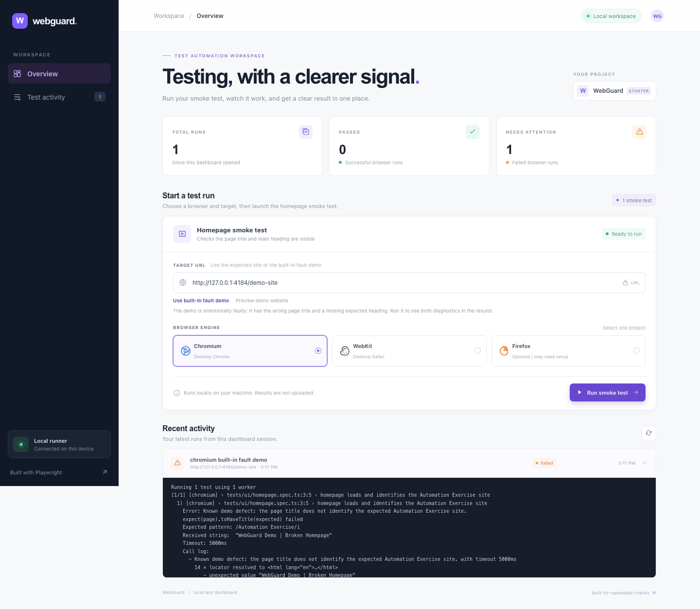

# WebGuard – Mini Project Report

## Automation Software Testing

<br><br><br>

| Submission detail | Information |
|---|---|
| Project title | WebGuard – Interactive Web Application Testing Dashboard |
| Submitted by | [Student name] |
| Course | Master of Computer Applications (MCA) |
| Subject | Automation Software Testing |
| Institution | [College / university] |
| Academic year | [Academic year] |
| Project guide | [Guide name] |

<br><br>

**Project repository:** [github.com/rlohan318/WebGuard](https://github.com/rlohan318/WebGuard)

**Project type:** Playwright UI testing framework with a local interactive dashboard

<br><br><br>

> **Submission note:** Replace the bracketed personal and academic fields before submitting. Add your own screenshots from the test runs where indicated. This report describes only implemented and observed behavior; planned test areas are labelled accordingly.

\newpage

## Acknowledgement

I would like to express my sincere gratitude to **[Project guide name]** for guidance and feedback during the development of this mini project. I also thank **[Department / institution]** for providing the opportunity to study and apply software testing concepts.

I acknowledge the maintainers of Playwright and the Automation Exercise practice website for making tools and a public practice target available for learning. The local sample storefront included in WebGuard is an original test fixture created for this project; it is deliberately defective and is not a production website.

Finally, I thank my classmates, friends, and family for their encouragement and support during the project.

\newpage

## Abstract

WebGuard is a small web application automation testing project built with TypeScript and Playwright Test. It demonstrates browser-based smoke testing through an interactive dashboard that runs a test locally and presents the run status and Playwright output.

The implemented smoke test checks that a homepage has the expected title and main heading. The default external practice target is Automation Exercise. Because a public website may be busy or unavailable, WebGuard also includes a local sample storefront with two intentional defects: an unexpected document title and a missing expected heading. Running the test against that fixture demonstrates how assertions identify faults without relying on the external service.

The dashboard offers browser selection, a target URL field, run history, status counters, and expandable test output. The server binds to the local loopback interface and keeps run history in memory. The project currently implements one smoke-test scenario; API, database, network, load/performance, and broader user-flow coverage are not claimed as completed.

**Keywords:** software testing, test automation, Playwright, TypeScript, browser testing, defect reporting, smoke testing.

\newpage

## Contents

1. Introduction and problem statement
2. Project objectives
3. Test scope
4. Test environment
5. Test design and scripts
6. Defect report and severity model
7. Test execution report
8. Conclusion and evidence
9. References

\newpage

## 1. Introduction and problem statement

### 1.1 Introduction

Software teams repeatedly verify that important pages continue to load and display expected content. Manual repetition takes time and can produce inconsistent results. Browser automation makes these checks repeatable and records what happened during a run.

WebGuard demonstrates a compact workflow: select a browser and target in a local dashboard, start a Playwright smoke test, and review its status and diagnostic output. It is a testing tool, not a website hosting or e-commerce system.

### 1.2 Problem statement

A browser test can fail for different reasons: the target can be unavailable, the wrong target can be configured, or the target page can lack expected content. A useful starter framework should distinguish these situations, expose the assertion output, and provide a predictable local example of a faulty page.

### 1.3 Proposed solution

WebGuard uses Playwright Test for navigation and assertions. Its Node.js dashboard server starts the selected test project, supplies the configured target URL, prevents overlapping runs, and exposes run logs to the browser UI. The built-in Maple & Main demo storefront intentionally violates two expectations so that failure reporting can be exercised locally.

### 1.4 Project architecture

```text
Dashboard in browser
        │
        ├── Select target and browser
        ▼
Loopback-only Node.js dashboard server
        │
        ├── Start Playwright CLI
        ├── Stream run status and output
        ▼
Playwright homepage smoke test
        │
        ├── External Automation Exercise target
        └── Local WebGuard fault-demo storefront
```

The browser test checks the document title and expected main heading. Failure screenshots and traces are configured in Playwright. Dashboard history is in memory only and is cleared when the server stops.

\newpage

## 2. Project objectives

### 2.1 Primary objectives

- Build a reusable starting point for browser-based web application testing.
- Use TypeScript, Playwright Test, semantic locators, and assertions.
- Provide a dashboard to start a smoke test and view its run output.
- Allow the tester to choose a configured browser project and target.
- Demonstrate meaningful defect diagnostics using a controlled local faulty page.
- Preserve screenshots and traces for failed Playwright runs.

### 2.2 Learning objectives

- Understand the difference between a test failure and an unavailable target.
- Practice browser navigation, title validation, role-based locators, and visibility assertions.
- Interpret expected and actual values in assertion output.
- Record defect severity, priority, evidence, and reproducibility.
- Recognize the limits of a smoke test and avoid claiming unimplemented coverage.

### 2.3 Measurable project deliverables

| Deliverable | Expected result |
|---|---|
| Browser smoke test | Verify title and main heading on the expected homepage |
| Local dashboard | Start a browser run and display status and output |
| Fault-demo website | Provide a deterministic local page with known defects |
| Diagnostic output | Identify actual title and list visible headings when assertions fail |
| Failure evidence | Playwright screenshot and trace for failed test runs |

\newpage

## 3. Test scope

### 3.1 Implemented and exercised scope

| Test area | Included behavior | Current status |
|---|---|---|
| UI smoke test | Navigate to the page; verify HTTP response, page title, and expected heading | Implemented |
| Fault diagnosis | Report title mismatch and missing expected heading on local fixture | Implemented and exercised |
| Dashboard behavior | Select target/browser, start run, prevent overlapping runs, view output and history | Implemented |
| Browser execution | Chromium and WebKit Playwright projects | Configured; recent verification depends on environment and target availability |
| Failure evidence | Screenshot and trace retention in Playwright configuration | Configured |

### 3.2 Broader testing approaches

The following approaches are useful extensions to the project, but do not exist as completed test suites in this version.

| Approach | Example coverage | Project status |
|---|---|---|
| UI functional testing | Login, registration, product search, cart, forms, and navigation | Not implemented |
| Responsive testing | Layout and controls across mobile, tablet, and desktop viewports | Not implemented |
| Load and performance testing | Response time under controlled concurrent traffic, page performance metrics | Not implemented |
| Cross-browser testing | Compare the same workflow across Chromium, Firefox, and WebKit | Only one smoke scenario; Firefox launch has not been verified in this environment |
| API testing | Endpoint status, schema, response values, and error handling | Not implemented |
| Database testing | Data integrity and persistence checks through an authorized test interface | Not implemented |
| Network testing | Request failures, redirects, offline behavior, and resource loading | Not implemented |

### 3.3 Test boundaries

- The test asserts the Automation Exercise title and homepage heading; a different website is not a valid target for this scenario.
- The local Maple & Main storefront is a diagnostic fixture, not a live shopping application.
- The demo is intentionally expected to fail the homepage assertions. Its failure is the expected result of the demonstration, not evidence that the WebGuard runner itself failed.
- Testing beyond the local demo or public practice site should only be performed on systems for which the tester has authorization.

\newpage

## 4. Test environment

### 4.1 Software and tools

| Component | Environment |
|---|---|
| Language | TypeScript |
| Test framework | Playwright Test |
| Runtime | Node.js |
| Package manager | npm |
| Dashboard server | Node.js built-in HTTP server |
| Default browser projects | Chromium and WebKit |
| Optional browser project | Firefox; requires a usable local Playwright Firefox installation |
| Default external target | `https://automationexercise.com` |
| Local fault-demo target | `http://127.0.0.1:4173/demo-site` (default dashboard port) |
| Reporting | Playwright list output and HTML report |
| Failure artifacts | Screenshot and trace |

Exact runtime and browser versions vary by installation. Record the versions used for the final academic run if they are required by the institution.

### 4.2 Starting a local run

From the project directory, install dependencies and browser binaries if they are not already installed:

```bash
npm install
npx playwright install chromium webkit
```

Start the dashboard:

```bash
npm run dashboard
```

Open `http://127.0.0.1:4173`. Choose **Use built-in fault demo** to run against the local fixture, or keep the default Automation Exercise target when the external site is available. Select a browser and click **Run smoke test**.

The test can also be run from a terminal:

```bash
npm run test:chromium
npm test
```

To open a generated Playwright HTML report:

```bash
npx playwright show-report
```

The local dashboard binds to loopback. It is not intended to be exposed as a public test service.

\newpage

## 5. Test design and scripts

### 5.1 Implemented test script

**Test ID:** WG-UI-001

**Test name:** Homepage loads and identifies the Automation Exercise site

**Test type:** UI smoke test

**Precondition:** The selected target is either the Automation Exercise homepage or the built-in WebGuard fault-demo route. The selected browser binary is installed.

| Step | Action | Expected result |
|---|---|---|
| 1 | Navigate to the configured target | A successful HTTP response is received |
| 2 | Read the document title | Title contains “Automation Exercise” |
| 3 | Locate the expected main heading by accessible role and exact name | Heading is visible |
| 4 | On the fault demo, collect visible headings for diagnostics | Test output identifies the page's actual headings |

The two content assertions are soft assertions so that a single demo run can report both defects. The navigation status is checked first because a server error (for example HTTP 503) is a target availability problem and should not be misreported as a content defect.

### 5.2 Assertion and locator strategy

- `page.goto` navigates to the root page or the local demo route.
- The response status check reports when the target fails to return a successful HTTP response.
- `toHaveTitle` validates the page identity using a regular expression.
- `getByRole("heading", ...)` verifies visible, user-facing content through its semantic role.
- `expect.soft` records both content failures in one demo run instead of stopping at the first mismatch.
- The failure message includes the current page URL, actual title, expected heading, and visible headings.

### 5.3 Known-fault demonstration

Run the dashboard and select **Use built-in fault demo**. The fixture is a locally served decorative storefront called Maple & Main. The page itself contains a test-notes panel describing the deliberately injected issues:

1. The document title is `WebGuard Demo | Broken Homepage`, which does not match the title expected by the test.
2. Its main heading is `Little things. Lovely living.`, so the expected Automation Exercise heading is missing.

The expected output is a failed smoke test with both diagnostics. This is a controlled negative test of the assertion and reporting workflow.

\newpage

## 6. Defect report and severity model

### 6.1 Severity definitions

| Severity | Meaning |
|---|---|
| Critical | Core system unusable or severe data/security impact; no reasonable workaround |
| High | Major user flow is blocked or core function is incorrect |
| Medium | Important behavior is impaired, but other core functionality remains usable |
| Low | Minor content, visual, or usability issue with limited functional impact |

**Priority** describes how soon an issue should be addressed. Severity describes the impact if it remains. The local demo defects are intentionally present and are recorded as known fixture defects, not defects in a production application.

### 6.2 Known demo defects

| Bug ID | Summary | Severity | Priority | Status |
|---|---|---|---|---|
| DEMO-001 | Document title does not identify the expected Automation Exercise homepage | High for the homepage identity check | P2 – Normal | Intentional / Open in demo fixture |
| DEMO-002 | Expected homepage heading is missing from the fixture | High for the homepage content check | P2 – Normal | Intentional / Open in demo fixture |

### 6.3 Bug details

#### DEMO-001 — Unexpected document title

- **Environment:** Local WebGuard dashboard and Chromium or another available browser project.
- **Steps to reproduce:** Start the dashboard; choose **Use built-in fault demo**; start the homepage smoke test.
- **Expected:** The title matches `/Automation Exercise/i`.
- **Actual:** The title is `WebGuard Demo | Broken Homepage`.
- **Evidence:** Playwright title assertion output shows the expected pattern and the received title.
- **Impact:** A title-based page identity check correctly rejects the fixture.
- **Disposition:** Keep this defect in the demo so the diagnostic can be demonstrated.

#### DEMO-002 — Expected main heading missing

- **Environment:** Local WebGuard dashboard and Chromium or another available browser project.
- **Steps to reproduce:** Follow the same steps as DEMO-001.
- **Expected:** A visible heading named `Full-Fledged practice website for Automation Engineers`.
- **Actual:** That heading is absent; the fixture instead shows headings such as `Little things. Lovely living.` and `Made to make you smile.`
- **Evidence:** Playwright locator assertion output includes the expected accessible heading and the list of visible headings.
- **Impact:** The homepage content check correctly identifies the missing expected content.
- **Disposition:** Keep this defect in the demo so the diagnostic can be demonstrated.

### 6.4 Environment issue, not a demo defect

The external practice site may return an HTTP 503 “queue full” response when overloaded. That is a target availability result, not a failure of the local test runner or the local fixture. WebGuard reports the response status before it evaluates page content. A run against another site, such as Google, is also expected to fail because it does not serve the page required by this test.

\newpage

## 7. Test execution report

### 7.1 Test report table

| Test ID | Test input / target | Expected outcome | Actual outcome | Status | Priority |
|---|---|---|---|---|---|
| WG-UI-001 | Local Maple & Main fault demo, Chromium | HTTP success; Automation Exercise title and heading are present | HTTP success; title is `WebGuard Demo | Broken Homepage`; expected heading is absent. Both issues appeared in output. | Failed as designed; diagnostics verified | P2 |
| WG-UI-001 | Automation Exercise, Chromium | Homepage title and expected heading are present | Latest attempt received HTTP 503 (queue full), so content assertions were not reached | Blocked by external target availability | P2 |
| WG-UI-001 | Google, Chromium (user-provided run) | Homepage title and expected heading are present | Page title was `Google`; it is not the expected test target | Failed due to incorrect target | P2 |

**Test input** records the target and browser selected. **Expected outcome** is the assertion requirement. **Actual outcome** records observed behavior. **Status** distinguishes a planned/intentional negative-test failure from an environment block.

### 7.2 Result summary

| Measure | Observed result |
|---|---|
| Implemented scenarios | 1 homepage smoke-test scenario |
| Local fault-demo defects | 2 intentional defects |
| Demo diagnostics verified | Title mismatch and missing heading |
| External target availability | HTTP 503 observed during a recent run |
| Google-target diagnostic | Actual title `Google` reported; not a valid target for this scenario |
| API, database, load, and network suites | Not implemented |

### 7.3 Interpreting the run output

When the local demo is selected, two assertion failures are expected. The first should identify the actual page title; the second should name the missing expected heading and list the visible headings. This proves that the test produces useful diagnostics rather than only a generic “failed” result.

If the run reports `received HTTP 503`, retry later or use the local fault demo. If it reports a title such as `Google`, verify the target URL field before starting the test. A non-demo target must serve the expected Automation Exercise homepage.

\newpage

## 8. Conclusion and evidence

### 8.1 Conclusion

WebGuard demonstrates a complete starter workflow for local browser smoke testing: choose a target and browser, start Playwright, observe status, and inspect failure output in a dashboard. The local storefront provides a repeatable example with two known defects. The diagnostic run confirmed that the title assertion and heading locator report separate, actionable failures.

The project is intentionally limited to one implemented smoke scenario. A public target's HTTP 503 response and a run against Google illustrate why target selection and availability must be recorded separately from application defects. The local fixture remains usable when the external service is unavailable.

### 8.2 Screenshot evidence

The following project screenshots show the built-in fixture and a completed run with its diagnostic output:





The Playwright configuration retains raw screenshots and traces for failed runs in `test-results/`; those temporary run artifacts are excluded from Git. The two report-specific screenshots above are saved under `docs/evidence/` and are included with the project. Do not edit failure output in a way that changes the recorded result.

### 8.3 Sample output from the local fault demo

```text
Known demo defect: the page title does not identify the expected Automation Exercise site.
Expected pattern: /Automation Exercise/i
Received string: "WebGuard Demo | Broken Homepage"

Known demo defect: expected heading
"Full-Fledged practice website for Automation Engineers" is missing.
Visible headings:
["Little things.Lovely living.", "Made to make you smile.",
 "Sunday Morning Candle", "Everyday Ceramic Vase",
 "The Slow Sunday Throw", "This sample has two intentional defects."]
```

This is representative output from the verified demo run. The exact timing, line numbers, and visible heading list can vary with the installed Playwright version.

## 9. References

1. Microsoft. **Playwright documentation**. https://playwright.dev/docs/intro
2. Playwright. **Playwright Test assertions**. https://playwright.dev/docs/test-assertions
3. Automation Exercise. **Practice website**. https://automationexercise.com
4. WebGuard project source and run instructions. https://github.com/rlohan318/WebGuard
